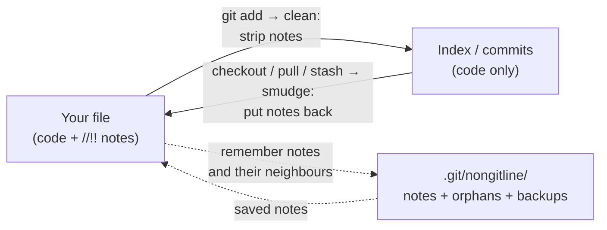

# nonGitLine

[](https://github.com/berat-erkul/nonGitLine/actions/workflows/test.yml)


[](LICENSE)

**Keep personal notes inside your source code without ever committing them.**

Mark a comment line with `//!!` and it stays in your local file but never reaches a commit, a push or GitHub. There is no extra step before committing: you keep using git as usual.

```java
//!! Note to self: the repository is injected through the port, not the adapter.  ← only on your disk
public class OrderService {
    //!! Why final? Value objects must be immutable, see the DDD notes.             ← only on your disk
    private final OrderRepository repository;
}
```

What gets committed:

```java
public class OrderService {
    private final OrderRepository repository;
}
```

The note lines are removed completely, not left as blank lines. Your file on disk is never touched, and the notes survive `pull`, `rebase`, `stash`, `checkout` and `reset --hard`.

[Türkçe README](README.tr.md) · [Design notes](docs/DESIGN.md)

---

## Why

When you are learning a codebase, a framework or a course project, the most useful notes are the ones written next to the code they explain. You don't want them in the shared history, though. Your current options are:

- Delete them before every commit. Tedious, and sooner or later one slips through.
- Keep them in a separate file. They lose their place in the code.
- Use `.gitignore` or `skip-worktree`. These work on whole files, not on individual lines.

nonGitLine works on single lines: your notes stay where you wrote them, and only the code is committed.

## Features

- **Line-level privacy.** Only lines marked with `//!!` are kept out of commits; everything else is committed byte for byte.
- **Works with your existing workflow.** It plugs into git itself (a [filter driver](https://git-scm.com/docs/gitattributes#_filter) and two hooks), so the terminal, IntelliJ, Rider and VS Code all go through it.
- **Notes survive git rewriting files.** `pull`, `merge`, `rebase`, conflicts, `stash`, branch switches and `reset --hard` put every note back above the code it belongs to.
- **Lost notes are kept, not dropped.** If the code a note was attached to is deleted upstream, the note is kept as an *orphan* and you are told about it.
- **Three layers against leaks.** The filter strips notes on `git add`, pre-commit blocks suspicious lines, and pre-push refuses to send any commit that still contains a note.
- **Fails closed.** If the filter crashes, `git add` fails instead of committing your notes.
- **Respects partial staging.** `git add -p` works as before; unstaged changes stay unstaged.
- **Knows the language.** A small Java/C# lexer tells a comment from `//!!` inside a string, a Java text block, a C# verbatim string or a C# raw string literal.
- **Preserves the file's bytes.** CRLF/LF line endings, a UTF-8 BOM and a missing final newline are kept as they were.
- **Fast.** One long-running process per git command: about 0.17 s for 300 files.
- **No dependencies.** One Python file using only the standard library.
- **Nothing is committed to your repo.** All configuration lives in `.git/`, so collaborators see a normal repository.

## Requirements

- macOS or Linux
- Python 3.9 or newer (`python3` on `PATH`; the system Python on macOS is enough)
- git 2.11 or newer (tested with 2.50)
- Supported languages: Java (`*.java`) and C# (`*.cs`)

## Quick start

```bash
# 1. Get the tool and put it on your PATH
git clone https://github.com/berat-erkul/nonGitLine.git ~/tools/nonGitLine
mkdir -p ~/.local/bin
ln -s ~/tools/nonGitLine/nongitline ~/.local/bin/nongitline   # make sure ~/.local/bin is on PATH

# 2. Enable it in a repository
cd ~/code/my-project
nongitline install
```

That's it. Write `//!!` notes and commit as usual.

`install` writes the path it was called with into the repository's git config and hooks. If you install through the symlink above, you can later move the clone and only need to update the symlink.

### What `install` changes

Everything stays inside `.git/`; nothing ends up in a commit.

| File | Content | Purpose |
| --- | --- | --- |
| `.git/config` | `filter.nongitline.process`, `filter.nongitline.required = true` | Registers the filter. `required` makes git stop if the filter fails. |
| `.git/info/attributes` | `*.java filter=nongitline`, `*.cs filter=nongitline` | Selects the files to filter, without a committed `.gitattributes` |
| `.git/hooks/pre-commit`, `.git/hooks/pre-push` | `nongitline check …` | Last checks before commit and push |

If either hook already exists and was not written by nonGitLine (for example Husky or a team hook), `install` stops without changing anything and prints the line to add to that hook yourself. `core.hooksPath` is respected.

`nongitline uninstall` removes all three. Your notes stay in your files; from then on they show up as normal changes.

## Writing notes

A note is a **whole line** that starts with `//!!`, after optional indentation.

| You write | Result |
| --- | --- |
| `//!! explain this` | Kept on disk, removed from the commit |
| `    //!! indented note` | Same; indentation does not matter |
| Several `//!!` lines in a row | Treated as one block and moved together |
| `int x = 5; //!! why 5?` | **Commit blocked.** Only whole-line notes are supported; move the note to its own line. |
| `// !! looks like a typo` | **Commit blocked**, because it looks like a mistyped marker |
| `//!!` at the start of a line inside a text block, `@"..."` or `"""..."""` | Treated as string data and not removed. The commit is blocked so you can check; commit with `--no-verify` if it is intended. |
| `//!!` inside a `/* ... */` block comment | Removed as a note, unless that line also closes the comment |

## What happens in everyday git

| You run | What you see |
| --- | --- |
| `git add`, `git commit` | The commit contains your code without the notes |
| `git diff`, `git add -p` | Notes never appear in diffs |
| `git status` after **adding or removing a note** | The file shows as ` M` with an empty diff until you `git add` it (see [Limitations](#limitations)). In the meantime git refuses to overwrite the file, so the note is safe. |
| `git fetch` | Nothing to do; fetch never touches your files |
| `git pull` (merge or rebase), `--autostash`, conflicts | Notes are put back above the code they belong to |
| `git switch` / `git checkout` and back | Notes come back on every branch where their code still exists |
| `git stash` / `git stash pop` | Notes stay in your file |
| `git reset --hard` | Notes stay; only code changes are reset |
| `git push` | Blocked if any outgoing commit contains a note |

## Orphans: when a note can't find its place

Each note remembers the code line right below it and the one right above it. When git rewrites the file, the note is placed:

1. above its old next line, if that line still exists unchanged; otherwise
2. below its old previous line, if that one still exists; otherwise
3. above or below an exact copy of either line, if that copy appears **exactly once** in the file.

If none of these works (for example, someone deleted the whole method), the note is **not guessed into place and not deleted**. It becomes an orphan and git prints:

```
nongitline: 1 note block(s) in src/Order.java could not be put back; they are kept, see: nongitline orphans
```

```bash
nongitline orphans                       # list orphans with the lines they used to sit between
nongitline orphans --drop src/Order.java # forget them once you have pasted them back by hand
```

Orphans are retried every time git writes that file again, so switching back to a branch where the code still exists brings them back automatically.

As a second safety net, the last 20 versions of every file that contained notes are kept under `.git/nongitline/backup/<path>/`.

## Commands

| Command | What it does |
| --- | --- |
| `nongitline install` | Enable in the current repository |
| `nongitline uninstall` | Disable; your notes stay in your files |
| `nongitline orphans [--drop <path>]` | List orphaned notes, or forget those of one file |
| `nongitline clean <path> < file` | Print the file as it would be committed (for debugging) |
| `nongitline smudge <path> < file` | Print the file with saved notes put back (for debugging) |
| `nongitline check pre-commit\|pre-push` | Hook entry points |
| `nongitline process` | The long-running filter that git starts by itself |

## How it works



- **clean** runs whenever git reads your file into the index (`add`, `commit -a`, `status`, `stash`). It strips the notes, returns the code to git and saves the notes with their neighbouring lines in `.git/nongitline/notes/`.
- **smudge** runs whenever git writes a file to disk (`checkout`, `merge`, `rebase`, `stash pop`, `reset --hard`, conflicts). It takes the new content from git, maps the old code to the new code with `difflib`, and puts each note back.
- **pre-commit** inspects the staged content for trailing or mistyped markers and for notes that should not be there.
- **pre-push** inspects every outgoing commit, without relying on the filter, and refuses the push if a note is found.

### Why smudge is essential

Clean alone is not enough, and this is the core problem the tool solves. Once a file is added, git compares the *cleaned* version with the index, sees no difference and treats the file as unmodified. From then on it overwrites the file without asking whenever `pull`, `rebase`, `stash`, a branch switch or `reset --hard` touches it, and a clean-only setup loses the notes. These behaviours were verified with a spike before any code was written; [docs/DESIGN.md](docs/DESIGN.md) has the results.

## Safety model

| Risk | Protection |
| --- | --- |
| A note reaches GitHub | Clean filter → pre-commit → pre-push. Each layer is independent; pre-push reads raw commit objects and does not rely on the filter. |
| The filter crashes | `required = true`: git aborts the operation, the index and your file are unchanged |
| The note store cannot be written | The filter reports an error and git stops, so no note is ever forgotten silently |
| Git overwrites the file | Smudge puts notes back; anything it cannot place becomes an orphan |
| The placement logic has a bug | Timestamped backups of every note-bearing version in `.git/nongitline/backup/` |
| Bytes change | Only whole note lines are removed; other bytes, line endings and the BOM are preserved. Non-UTF-8 and binary files are passed through untouched. |

## Limitations

- **Notes live in this clone's `.git/` only.** A fresh clone, another machine or a deleted folder does not have them. This is by design.
- **`git status` before `git add`.** When you add or remove a note, the file size changes and git reports the file as modified without looking at its content, so `git status` shows ` M` with an empty `git diff`. Running `git add` on the file clears it. Git itself behaves this way and a filter cannot change it.
- **`git archive` includes notes.** Git runs smudge for archives too and sends the filter the same information as for a checkout, so the filter cannot tell them apart. Zipping the folder includes your notes for the same reason. GitHub's "Download ZIP" is built from the commits and is clean. For a local archive without notes:
  ```bash
  git -c filter.nongitline.process= -c filter.nongitline.required=false archive HEAD -o project.zip
  ```
- **Renames.** Notes are stored per path. After `git mv`, notes stay with the old path and `nongitline orphans` lists them as "file not in the working tree".
- **Only whole-line notes**, only `//!!`, only Java and C# for now.
- **C# interpolated strings.** Holes like `{...}` are skipped by brace depth. A `}` inside a string inside a hole can confuse the lexer. The safe direction applies: a note may fail to be removed and the commit is then blocked; nothing leaks.
- **Not tested yet:** Windows, IDE partial commits (IntelliJ/Rider "commit selected lines" builds the index itself; the pre-commit and pre-push hooks still guard against leaks), `git worktree`, submodules, `cherry-pick`, interactive rebase.

## FAQ

**Is this a plugin or an app?**
Neither. It is a single command-line script that git calls through its filter and hook mechanisms. After `install` you don't run it yourself.

**Why not just a pre-commit hook that removes notes from the index?**
The index would then always differ from your file. `git status` and `git diff` would show your notes as permanent changes, `git commit --no-verify` would bypass the hook and leak the notes, and branch switches would be refused because of the "local changes". A filter avoids all three.

**Why not `.gitignore` or `git update-index --skip-worktree`?**
Both work on whole files. You want to share the code and keep only certain lines private.

**Does my team need to install it?**
No. Nothing is committed: no `.gitattributes`, no hooks. Collaborators see an ordinary repository with ordinary code.

**What if I stop using it?**
Run `nongitline uninstall`. Your notes stay in your files and from then on show up as normal changes; delete them or commit them as you prefer.

**Does it slow git down?**
Only files that contain notes, or had notes before, do any real work. All other files pass straight through one shared process. Measured: 300 files are added or checked out in about 0.17 s.

## Development

```bash
./test.sh
```

The suite builds throwaway repositories with a fake remote and a second clone acting as a teammate. It covers 43 checks: lexer cases, partial staging, byte preservation, a crashing filter, a filter that cannot save notes, leak blocking at push, merge/rebase/autostash pulls, conflicts, branch switches, stash, `reset --hard`, orphans and files larger than one protocol packet. It runs on the system `python3` and on Linux and macOS in CI.

To check that the tests actually catch note loss, the restore step was disabled in a copy of the tool: all 14 note-preservation checks failed as expected.

Design, spike results and the placement algorithm are described in [docs/DESIGN.md](docs/DESIGN.md).

## License

[MIT](LICENSE)
