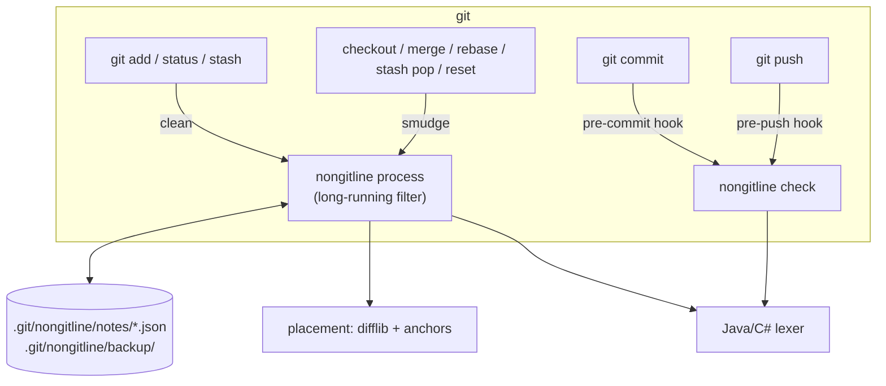

# nonGitLine design notes

These notes cover how nonGitLine works inside and why it is built this way. The [README](../README.md) covers usage.

## 1. Requirements

1. Lines marked `//!!` are recognised automatically.
2. Marked lines never end up in a commit.
3. The local file is not changed by committing; notes are never lost.
4. Unmarked code and ordinary comments are committed unchanged.
5. The normal git workflow stays the same.
6. With partial staging, unstaged changes don't leak into the commit.
7. Removing notes doesn't corrupt the rest of the file.
8. Comments are told apart from string contents in the supported languages.
9. A misused marker or a failed clean-up must not damage code or git state.

## 2. Why a clean filter alone is dangerous

A git *clean* filter rewrites content on its way into the index, which is exactly requirement 2. The trap is what git does next. Once a file is added, git compares `clean(file on disk)` with the index. They are equal, so git treats the file as **unmodified** and overwrites it freely:

| Operation | Touches the working tree? | With a clean-only filter |
| --- | --- | --- |
| `git fetch` | No, only objects and refs | Safe |
| `git pull` (merge), file not changed upstream | No | Safe |
| `git pull` (merge), file changed upstream | Yes, the merge result is written | **Notes lost** |
| `git pull --rebase` | Yes, upstream is checked out and commits are replayed | **Notes lost** |
| Conflict during pull | Yes, the conflicted file is written | **Notes lost** |
| `git stash` / `pull --autostash` | The stash stores the cleaned content, then the working tree is reset | **Notes lost** |
| Branch switch | Yes | **Notes lost** |
| `git reset --hard` | Yes | **Notes lost** |

So the tool also needs the reverse direction: a *smudge* step that puts notes back whenever git writes the file.

## 3. Spike: verifying git's behaviour first

Before writing any code, the assumptions above were checked in a throwaway repository. The clean filter was a `sed` command; the smudge filter logged each call and returned its input unchanged. Git 2.50.1, macOS.

| Case | Observed |
| --- | --- |
| File with a new note, not yet added | `status` shows ` M`: git sees the size change and does not compare contents |
| `pull` of an upstream change to such a file | Refused ("commit your changes or stash them"); the note is safe |
| After `add` + commit | The file on disk has the note, yet `working tree clean` |
| `pull` (merge) touching the file | **Note lost**; smudge was called |
| Conflict | The conflicted file went through smudge; **note lost** |
| `stash` / `stash pop` | The stash held the cleaned content; **note lost**; smudge called twice |
| Branch switch | **Note lost**; smudge was called |
| `git add -p`, `git diff` | Note lines never shown |
| Clean filter exits non-zero with `required=true` | `git add` exits 128; the index is unchanged |

**Conclusion:** every operation that loses a note goes through smudge. One restore point in smudge is enough to cover them all.

A later finding: `git archive` also runs smudge and sends the same `ref`/`treeish`/`blob` metadata as a checkout, so the filter cannot tell an archive from a checkout. This is listed as a known limitation.

## 4. Components



Everything is in one Python file using only the standard library. Python 3.9 compatibility matters: IDEs started from the macOS Dock get a minimal `PATH` and end up with `/usr/bin/python3`, which is 3.9.

## 5. The lexer

`line_kinds()` classifies each line as `note`, `trailing`, `typo` or ordinary, while tracking the state that carries across lines:

- code
- block comment `/* … */`
- Java text block `"""…"""` (backslash escapes)
- C# verbatim string `@"…"` (where `""` is an escaped quote), including `$@"…"` and `@$"…"`
- C# raw string literal with three or more quotes, closed by the same number of quotes

A line is a **note** when its first non-blank characters are `//!!` and it starts in code, or inside a block comment that this line does not close. The same text inside a multi-line string is data and is left alone.

Within a line, ordinary strings, character literals and C# interpolation holes `{…}` are skipped, so a `//` inside `"http://…"` is never mistaken for a comment. Interpolation holes are skipped by brace depth only; this simplification is marked in the code.

A wrong decision fails safe. If the lexer believes a note is inside a string, the note is left in the content, and both pre-commit and pre-push reject any line that starts with `//!!`, regardless of the lexer.

## 6. Note store and placement

For each file with notes, `.git/nongitline/notes/<path>.json` holds:

```json
{
  "base":    ["clean line 1\n", "clean line 2\n", "..."],
  "blocks":  [{"at": 3, "lines": ["//!! note\n"]}],
  "orphans": [{"lines": ["//!! ...\n"], "before": "prev line\n", "after": "next line\n"}]
}
```

- `base` is the cleaned content as last seen.
- `at` is the index of the clean line the block sits above.
- Writes are atomic (temp file + `os.replace`).

**clean** (git reads your file) splits notes from code, saves `base` and `blocks`, keeps existing orphans and returns the code. A note you deleted on purpose is simply absent from the new `blocks`, so it is not brought back.

**smudge** (git writes your file) maps the old `base` onto the new content with `difflib.SequenceMatcher` (autojunk off) and keeps only the `equal` runs. For each block:

1. If the old next line `base[at]` survived, insert the block above its new position.
2. Otherwise, if the old previous line `base[at-1]` survived, insert below it.
3. Otherwise, and for every existing orphan, accept a neighbour that occurs **exactly once** in the new content, matched by exact text.
4. Otherwise the block becomes an orphan and a warning is printed. It is never guessed into place and never dropped.

Two details protect the bytes:

- A note is not inserted after a final line that lacks a newline. That would change a code line; the note becomes an orphan instead.
- A note that was the last line of a file without a final newline gets a newline (matching CRLF if needed) when placed above another line.

Orphans are retried on every smudge of that file, so switching back to a branch where the code still exists restores them.

On top of the store, every note-bearing version seen by clean is backed up to `.git/nongitline/backup/<path>/<timestamp>`, keeping the last 20 and skipping duplicates. A failed backup only prints a warning, while a failed store write fails the filter: losing the store would mean losing notes later.

## 7. Guards

- **pre-commit** reads the staged blobs, so it respects partial staging. It rejects lines starting with `//!!` (the filter was bypassed or the lexer treated the note as string data), trailing `//!!` comments, and `// !!`-style typos.
- **pre-push** collects every commit that is being pushed and not yet on any remote. It reads the raw blobs of the changed `.java`/`.cs` files with `git cat-file` and rejects notes and trailing markers. It doesn't rely on the filter, so it also catches commits made with the filter disabled or the hook skipped.

Both can be bypassed on purpose with `--no-verify`.

## 8. Long-running filter process

The first version started one Python process per file: about 30 ms each, so a 300-file checkout took about 9 s, even for files without notes. Since `filter.<driver>.process` (git 2.11), git starts a single process per command and talks to it over the pkt-line protocol (`man gitattributes`, "Long Running Filter Process"):

```
git> git-filter-client / version=2 / 0000
   < git-filter-server / version=2 / 0000            ← must be flushed before reading on
git> capability=clean / capability=smudge / capability=delay / 0000
   < capability=clean / capability=smudge / 0000
git> command=smudge / pathname=A.java [/ ref= / treeish= / blob=] / 0000 / CONTENT… / 0000
   < status=success / 0000 / CONTENT… / 0000 / 0000
```

Content is split into packets of at most 65516 bytes. On an exception the process answers `status=error`; with `required=true`, git then aborts the operation for that file. With this, 300 files take about 0.17 s.

The first implementation deadlocked: it wrote the server greeting but did not flush it before waiting for the capabilities, so both sides waited on each other. `GIT_TRACE_PACKET=1` showed git's greeting going out and nothing coming back.

## 9. Testing

`test.sh` builds throwaway repositories with a bare "origin", a working clone, and a second clone acting as an upstream teammate. It runs on the system `python3`, with an isolated git config (`GIT_CONFIG_GLOBAL`, `GIT_CONFIG_NOSYSTEM`) so the user's settings such as `pull.rebase` cannot change the results.

To make sure the tests catch note loss, the restore step was replaced with a no-op in a copy of the tool. All 14 note-preservation checks failed, and the rest passed.

## 10. Real-world check

The tool was used on a 28-file ASP.NET Core MVC project. 234 whole-line comments became notes, and 38 trailing comments were moved onto their own lines above the code. Verification:

- the project built before the change;
- every committed `.cs` blob was byte-identical to an independently cleaned copy, and that copy built with 0 warnings and 0 errors;
- the files fetched back from GitHub through the API contained neither `//!!` nor `//`.
